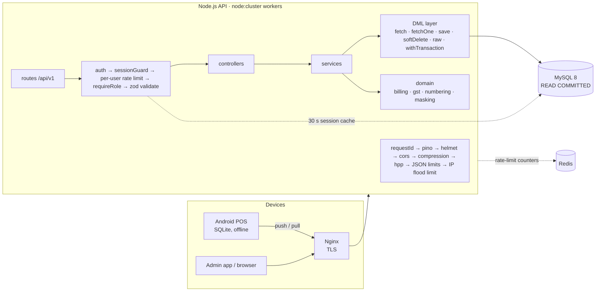

# Cloak Room Billing SaaS — Backend API

Multi-tenant REST API for railway / bus cloak rooms. Android POS devices bill **offline** (SQLite)
and synchronise with one shared MySQL through this API. Tenants (customers / operators) are
isolated by `customer_id`, taken only from the login token.

- **Contract for the Android app:** Swagger UI at `/api/docs`, spec in [`docs/openapi.json`](docs/openapi.json),
  Postman collection in [`docs/postman_collection.json`](docs/postman_collection.json).
- **Project rules / decisions:** [`CLAUDE.md`](CLAUDE.md) (single source of truth, incl. progress log).

## Stack

Node.js 20 · TypeScript (strict) · Express 4 · MySQL 8 (mysql2/promise) · zod v4 · JWT (HS256) ·
argon2id (`@node-rs/argon2`) · helmet · cors · express-rate-limit (+ Redis store) · hpp · compression ·
pino · Vitest + Supertest · ESLint + Prettier · zod-to-openapi + swagger-ui-express.

## Quick start (local)

Prerequisites: Node 20, MySQL 8 on `localhost:3306` (user `root`, empty password by default).

```bash
npm ci
cp .env.example .env          # then set JWT_ACCESS_SECRET / JWT_REFRESH_SECRET (≥ 32 chars each)
npm run migrate               # creates the database if missing, applies db/migrations/*.sql
npm run seed                  # super admin, ID proofs, GST 9+9 from 2017-07-01
npm run dev                   # http://localhost:4000
```

- Health: `GET /api/v1/health` · readiness (DB + schema): `GET /api/v1/ready`
- Docs: <http://localhost:4000/api/docs>
- Log in as the seeded super admin: `SUPER_ADMIN_USER_ID` / `SUPER_ADMIN_PASSWORD` from `.env`.

Generate secrets with `node -e "console.log(require('crypto').randomBytes(48).toString('base64url'))"`.

## Scripts

| Script | What it does |
|---|---|
| `npm run dev` | Watch mode (tsx), pretty logs |
| `npm run build` / `npm start` | Compile to `dist/` / run compiled server (cluster) |
| `npm run migrate` | Apply pending SQL migrations (`--status` to list); checksums + lock |
| `npm run seed` | Idempotent seeds (never resets an existing admin password) |
| `npm run lint` | ESLint + banned hard-`DELETE`/`TRUNCATE` check |
| `npm run typecheck` | `tsc --noEmit` |
| `npm test` / `npm run test:coverage` | Vitest (recreates `cloak_room_billing_test`), coverage thresholds |
| `npm run openapi` | Export `docs/openapi.json` + `docs/postman_collection.json` |
| `npm run loadtest` | Build, then autocannon load test → `docs/load-test-results.md` |
| `npm run format` | Prettier |

## Environment

Validated at boot with zod — the process exits on any invalid value. See [`.env.example`](.env.example).

| Variable | Default | Notes |
|---|---|---|
| `NODE_ENV` | `development` | `production` enforces non-default secrets/admin password |
| `PORT` | `4000` | |
| `DB_HOST` / `DB_PORT` / `DB_USER` / `DB_PASSWORD` / `DB_NAME` | localhost / 3306 / root / '' / cloak_room_billing | |
| `DB_POOL_LIMIT` | `20` | **per worker**; workers × pool < MySQL `max_connections` |
| `JWT_ACCESS_SECRET` / `JWT_REFRESH_SECRET` | — | required, ≥ 32 chars, different |
| `JWT_ACCESS_TTL` / `JWT_REFRESH_TTL` | `12h` / `30d` | |
| `CORS_ORIGINS` | — | comma-separated browser origins (Android sends none) |
| `REDIS_URL` | — | shared rate-limit store; required with > 1 worker/host |
| `SUPER_ADMIN_USER_ID` / `SUPER_ADMIN_PASSWORD` | superadmin / ChangeMe@123 | used by `npm run seed` |
| `LOG_LEVEL` | `info` | pino level |
| `CLUSTER_WORKERS` | `0` | 0 = one per CPU in production, 1 otherwise |
| `TRUST_PROXY` | `loopback` | Express `trust proxy` (e.g. `1` behind one Nginx) |
| `SHUTDOWN_TIMEOUT_MS` | `15000` | graceful-shutdown drain time |
| `DOWNLOADS_DIR` | `downloads` | APKs served at `/downloads/*.apk` |
| `API_DOCS_ENABLED` | `true` | Swagger UI + spec at `/api/docs` |
| `RATE_LIMIT_MULTIPLIER` | `1` | load testing only; must be 1 in production |

## Architecture



```
src/
  config/         env.ts (zod), constants.ts, defaults.ts (new-customer templates)
  core/db/        pool.ts, registry.ts (identifier whitelist), dml.ts, tx.ts
  core/http/      ApiError, response envelope, asyncHandler
  core/middleware requestId, auth + sessionGuard, requireRole, validate, rateLimit, errorHandler, notFound
  core/crud/      crudFactory (config → list/get/create/update/soft-delete)
  core/security/  password (argon2id), tokens (JWT, SHA-256), sessionStore (30 s LRU)
  domain/         billing, gst, numbering, masking — pure, 100 % unit-tested
  modules/<name>/ routes · controller · service · schema
  docs/           OpenAPI document + Swagger UI router
db/migrations/    NNN_*.sql   db/seeds/   scripts/ (migrate, seed, loadtest, export-openapi)
tests/unit · tests/integration       deploy/ (nginx, PM2, compose, backups)
```

**Ground rules** (enforced in code and tests):

- All data access goes through the DML layer: identifiers are checked against `information_schema`
  and back-quoted, values are always bound, tenant scoping and audit columns are automatic.
- **No hard deletes** — `softDelete()` only (ESLint rule + `scripts/check-no-delete.mjs` in CI).
- The tenant (`customer_id`) comes from the token only; a super admin passes it explicitly.
- `password_hash` / token hashes are never selected unless a caller names them; never returned.
- Every non-public route requires a valid session (route audit test fails otherwise).

## Sync contract (summary)

Full rules with examples are in the OpenAPI description (`/api/docs`).

- **Push** `POST /api/v1/sync/push` `{ luggage: [...], receipts: [...] }` — rows validated one by one;
  each gets `ACCEPTED` or `EXCEPTION` (+ `reason`) and **both** mean "mark synced". Idempotent.
  - Luggage (`trans_id` UUID from the QR): check-in fields write-once, check-out fields fill-only,
    `out_flag` never reverts — check-in on device 1 + check-out on device 2 = one row, any order.
  - Bills: one per `trans_id`; the server recomputes with the shared billing rules and logs
    `AMOUNT_MISMATCH` (bill kept) on any difference.
  - Counters (`U03-00125`, series R/B per user, reset D/M/Y in IST) only ever go up.
- **Pull** `GET /api/v1/sync/pull[?since=<server_time>]` — first pull: masters + settings + counters +
  open check-ins; later: changes since (with a 2-minute overlap — dedupe by PK), soft-deleted rows
  included. ≤ 1000 luggage rows per page: follow `next_cursor` while `has_more`.
- **Sessions:** one active session per user; force-logged-out devices may still push and log out.

## Testing & CI

`npm test` needs a local MySQL: the global setup drops and recreates `cloak_room_billing_test`
(guarded to `*_test` names), migrates and seeds it. Coverage gates: overall ≥ 80 %, `src/core` ≥ 90 %,
`src/domain` 100 %. Notable suites: `sync` (both Case 1 push orders, Case 2, idempotency,
exceptions, tenant isolation, 1 700-row batches), `auth`, `security` (route audit, token forgery,
log redaction), `openapi` (spec ↔ routes in sync).

CI (`.github/workflows/ci.yml`, MySQL 8.4 service): banned-DELETE check → lint → prettier →
typecheck → tests with coverage → build → fresh-DB migrate + seed twice.

## Load testing

`npm run loadtest` resets a disposable `<db>_load` database, seeds 200 users over 20 customers,
starts the built server as a cluster and measures login, pull and push with autocannon (plus
`EXPLAIN` of the hot queries). Results and production MySQL notes: [`docs/load-test-results.md`](docs/load-test-results.md).

## Deployment

**Topology:** Nginx (TLS) → API (Docker or PM2, one worker per CPU) → managed MySQL 8 in the
Mumbai region; Redis for shared rate limits.

1. **Database** — managed MySQL 8 (e.g. AWS RDS / Azure Database for MySQL, `ap-south-1` /
   Central India), utf8mb4, `binlog_format=ROW`, automated backups + point-in-time recovery,
   `innodb_buffer_pool_size` 50–70 % of RAM. Create an app user with DML + DDL rights on the schema.
2. **Configure** — production `.env` (strong JWT secrets, real `SUPER_ADMIN_PASSWORD`,
   `CORS_ORIGINS`, `REDIS_URL`, `TRUST_PROXY=1`, `DB_POOL_LIMIT` so workers × pool < `max_connections`).
3. **Migrate** — `npm run migrate && npm run seed` (or `docker build --target migrator`, see
   [`deploy/docker-compose.example.yml`](deploy/docker-compose.example.yml)). Safe to re-run.
4. **Run** — Docker: `docker build -t cloakroom-api .` (non-root, healthcheck on `/api/v1/ready`);
   or PM2: `npm run build && pm2 start deploy/ecosystem.config.cjs`.
5. **Nginx + HTTPS** — [`deploy/nginx.conf`](deploy/nginx.conf) (`client_max_body_size 6m`,
   keep-alive below the app's 65 s, `X-Request-Id`), certificates via certbot.
6. **Backups** — provider snapshots/PITR **plus** a daily logical dump:
   [`deploy/backup-mysql.sh`](deploy/backup-mysql.sh) (cron 03:00 IST, 14-day retention, ship off-host).
7. **Logs** — JSON to stdout (pino, secrets/PII redacted). Rotate with Docker `json-file`
   `max-size`/`max-file` (compose example) or `pm2-logrotate`.
8. **APK releases** — copy the APK into `DOWNLOADS_DIR`, then `POST /api/v1/app/version`
   (`apk_url: /downloads/<file>.apk`, `mandatory_flag`).

Graceful shutdown: SIGTERM/SIGINT → stop accepting, drain in-flight requests (≤ `SHUTDOWN_TIMEOUT_MS`),
close the MySQL pool and Redis.

## Open points

Business confirmations pending (also `TODO(open-point)` in code): customer summary report fields ·
Aadhaar masking legal sign-off · FY numbering format with the CA · IGST seed rate (seeded 0 %) ·
whether `GST_FLAG = N` means 0 % GST · `TOTAL_COLLECTION_FLAG` semantics · registration
`user_count` vs `user_limit`.
